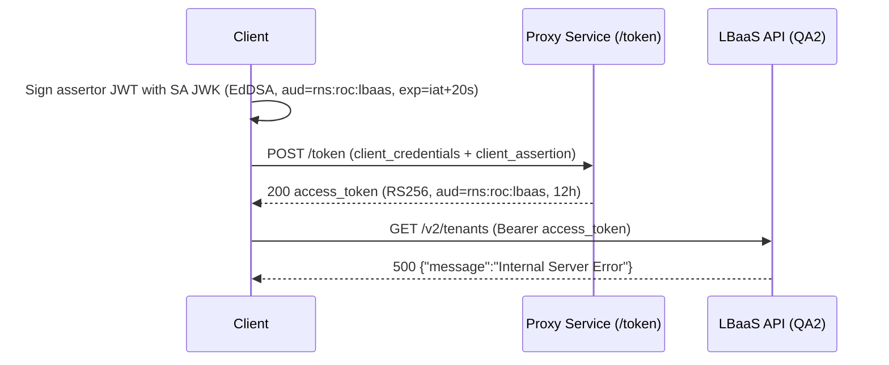
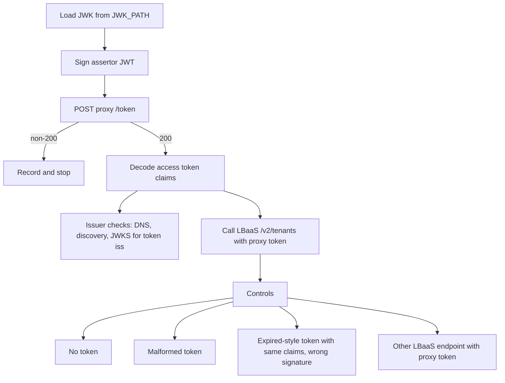

# Design: LBaaS Proxy Service Auth PoC

## Research Question

Why does an access token issued by the new proxy service for a service account get rejected with HTTP 500 by the LBaaS API, and which part of the service-to-service flow causes it?

**Source test:** [New Proxy Service - LBaaS Test](https://confluence.rakuten-it.com/confluence/spaces/UCP/pages/6977413500/New+Proxy+Service+-+LBaaS+Test)

---

## Observed Failure

Facts from the source test:

| Item | Value |
|---|---|
| Assertor `aud` | `rns:roc:lbaas` |
| Access token `iss` | `https://qa2-accounts-onecloud.rakuten-it.com/auth/realms/roc` |
| Access token `aud` / `azp` | `rns:roc:lbaas` / `rns:roc:iam` |
| Access token groups | `rns:roc:lbaas::clsd-ucp:roles:lbaas-operator`, `rns:roc:lbaas::clsd-ucp:roles:lbaas-viewer` |
| Access token lifetime | 43200 s |
| LBaaS response | `500`, body `{"message":"Internal Server Error"}`, header `x-request-id` |

The proxy accepts the assertor and issues a token. The failure appears only at the LBaaS call, and it is a 500 rather than a 401 or 403.

---

## Hypotheses

| ID | Hypothesis | What it predicts |
|---|---|---|
| H1 | The token `iss` host is not a resolvable or trusted issuer for LBaaS. LBaaS fails while resolving the issuer's OIDC discovery or JWKS and surfaces the error as 500. | The issuer host does not resolve or serve discovery. A token with a different, valid `iss` produces 401/403 or 200. |
| H2 | LBaaS fails on a claim the proxy token does not carry (for example a tenant-scoping claim), and the missing claim causes an unhandled error. | Garbage or expired tokens return 401, while the proxy token returns 500 at the same endpoint. Other LBaaS endpoints may behave differently. |
| H3 | The 500 is independent of the token (an LBaaS backend fault on `/v2/tenants`). | Every request to the endpoint returns 500, including requests with a token from a known-good path. |
| H4 | The proxy token's `aud` is a JSON string. LBaaS expects an array and fails when parsing a string. | A token from the same realm with an array `aud` is accepted. Changing the assertor `aud` or the requested `scope` may change the issued `aud` type. |
| H5 | The proxy token's `azp` (`rns:roc:iam`) is not in its `aud` (`rns:roc:lbaas`), and LBaaS fails on that mismatch. | A token whose `azp` is among its `aud` entries is accepted. |

---

## Scope

**In scope:**
- Replaying the four steps from the source test against the real QA environment
- Decoding and printing the header and claims of the assertor and access tokens (tokens themselves are never written to disk or docs)
- Checking the `iss` host: DNS resolution, OIDC discovery and JWKS fetch
- Control calls to LBaaS that separate token-validation failures from endpoint failures
- A known-good control: a token from a user login to the QA2 OC portal, called against the same endpoint and compared claim by claim with the proxy token
- Client-side variants that could change the issued token: assertor `aud` as an array, a requested `scope`, a different or multiple services in the assertor `aud`
- The same token against LBaaS v3 (`/v3/version`, `/v3/tenants`) on a QA user DLB host
- Recording status, body and `x-request-id` for every call so the LBaaS owners can trace the failing request

**Out of scope:**
- Fixing the proxy service or LBaaS
- Load or scale behavior
- Any environment other than OC QA / LBaaS QA2

---

## Approach

A standalone Go program in the kitchen-sink repo runs the flow as ordered steps and prints one result block per step.

### Steps

1. **Assertor**: sign a JWT with the service account JWK using EdDSA, with `iss` and `sub` set to the service account, `aud=rns:roc:lbaas`, `exp = iat + 20s` and a fresh `jti`.
2. **Token exchange**: POST to the proxy `/token` endpoint with `grant_type=client_credentials` and the JWT-bearer client assertion.
3. **Claim decode**: print the access token header and claims; print the `iss` host.
4. **Issuer checks**: resolve the `iss` host, fetch `<iss>/.well-known/openid-configuration` and its `jwks_uri`.
5. **LBaaS call**: `GET /v2/tenants` with the proxy token; record status, body and `x-request-id`.
6. **Controls**: repeat the LBaaS call with no token, a malformed token and a correctly shaped token with an invalid signature; call a second LBaaS endpoint with the proxy token.
7. **Variants**: repeat steps 1–5 with the assertor `aud` as a single-element array, with `scope=openid profile rns:roc:lbaas` on the token request, with both, with two services in the assertor `aud`, with a different service (`rns:roc:caas`), and with a bare `lbaas`.
8. **Known-good comparison**: call `GET /v2/tenants` with a QA2 portal user token and compare its `iss`, `aud` (type and entries), `azp`, groups and claim names with the proxy token.
9. **LBaaS v3**: call `GET /v3/version` and `GET /v3/tenants` with the proxy token on `LBAAS_V3_BASE_URL`. LBaaS v3 is served by the user DLB hosts (`https://<region>-user-dlb.r-local.net/v3`, with `qa-` and `dev-` prefixes for non-prod), not by the v2 host.

### Configuration

| Variable | Purpose |
|---|---|
| `JWK_PATH` | Path to the downloaded service account JWK |
| `SA_ACCOUNT` | Service account identifier used for `iss` and `sub` |
| `PROXY_TOKEN_URL` | Proxy service `/token` URL |
| `LBAAS_BASE_URL` | LBaaS v2 base URL (QA2) |
| `LBAAS_V3_BASE_URL` | LBaaS v3 base URL; defaults to `LBAAS_BASE_URL`. QA: `https://qa-jpe2-user-dlb.r-local.net` |
| `TLS_INSECURE` | When `true`, skip TLS verification for the proxy call (the source test uses `curl -k`) |
| `ASSERTOR_AUD` | Comma-separated assertor `aud` value(s); default `rns:roc:lbaas` |
| `ASSERTOR_AUD_ARRAY` | When `true`, the assertor `aud` is sent as an array even with a single entry |
| `TOKEN_SCOPE` | Value of the `scope` parameter on the token request (unset by default) |
| `CONTROLS` | When `false`, skip the control calls in step 6 |

---

## Success Criteria

| Criterion | Pass condition |
|---|---|
| Failure reproduced | Steps 1–5 return proxy 200 and LBaaS 500 with the same body as the source test |
| Token facts confirmed | Printed `iss`, `aud`, `azp` and groups match the observed-failure table |
| Issuer validity determined | Step 4 records whether the `iss` host resolves and serves discovery and JWKS |
| 500 localised | Controls show whether 500 is specific to the proxy token (H1/H2) or occurs for all requests (H3) |
| Known-good control | A QA2 portal token is accepted by `/v2/tenants`, and its claim differences from the proxy token are listed |
| Client-side levers | Each variant records whether the issued `aud` and `azp` change |
| LBaaS v3 | The proxy token is accepted by `/v3/version` and `/v3/tenants` on a QA user DLB host, and the response region matches |
| Traceable | `x-request-id` for each failing call is recorded in the PoC report |

---

## Risks and Open Questions

| Item | Detail |
|---|---|
| Network access | The proxy and LBaaS hosts are on `r-local.net` and require internal network access from the machine running the PoC. |
| JWK handling | The JWK is a secret and is supplied through `JWK_PATH` only. It is never committed or copied into docs. |
| Known-good token | The control is a user token from a QA2 portal login. It lives 10 minutes, is supplied by the user, and is held in memory only. A token for the service account itself from the realm, not through the proxy, is not available. |
| Server-side changes | The `aud` type and `azp` of the issued token are set by the proxy; the PoC cannot change them and cannot see server-side configuration or logs. |
| Environment hosts | LBaaS v3 QA hosts are `qa-<region>-user-dlb.r-local.net`. Prod hosts (`<region>-user-dlb`) accept only prod-realm tokens and must not receive QA2 tokens. |
