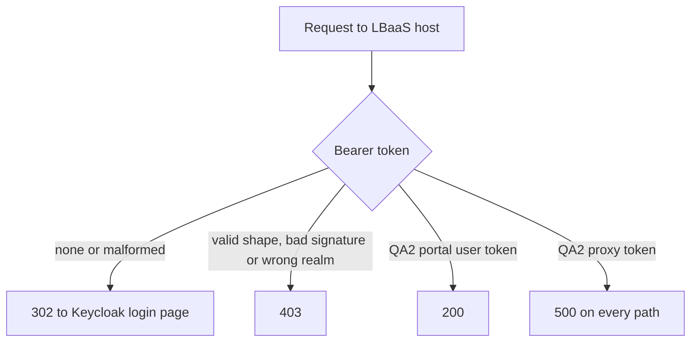

# PoC Report: LBaaS Proxy Service Auth

**Research question answered:** Why does an access token issued by the new proxy service for a service account get rejected with HTTP 500 by the LBaaS API, and which part of the service-to-service flow causes it?

## Verdict

The failure from the [source test](https://confluence.rakuten-it.com/confluence/spaces/UCP/pages/6977413500/New+Proxy+Service+-+LBaaS+Test) reproduces on every run. The proxy issues a token with a valid issuer and signature. The LBaaS entry layer then fails with 500 for every path on that host, after signature validation passes.

A user token from the same QA2 realm with the same LBaaS groups is accepted (200). The issuer, the realm, the LBaaS groups and JWKS reachability are therefore not the cause. The remaining differences between the two tokens are the type of `aud`, `azp`, and several claims the proxy token does not carry. The PoC does not isolate which one LBaaS fails on. The client chooses the target service through the assertor `aud`; the `aud` type (always a string) and `azp` (always `rns:roc:iam`) do not change with anything the client sends.

## What the PoC proved

| Finding | Observed |
|---|---|
| Proxy token exchange works | 200, `expires_in=43200`, RS256 token |
| The token `iss` is `https://qa2-accounts-onecloud.rakuten-it.com/auth/realms/roc`, which resolves and serves OIDC discovery and JWKS (all 200) | issuer is not the cause |
| LBaaS returns 500 for the proxy token at `/v2/tenants`, `/`, `/v2`, `/v2/health`, `/healthz` | the failure is not specific to `/v2/tenants` |
| A bad signature returns 403, no token or a malformed token redirects to login | the 500 depends on the token and occurs after signature validation |
| A QA2 portal user token with the same LBaaS groups returns 200 on `/v2/tenants` | the LBaaS roles and the realm are not the cause |
| A user token from the other realm (`accounts-onecloud`, no `qa2-`) returns 403 on `/v2/tenants` and `/v2/health` | LBaaS QA2 rejects tokens from another realm at signature or issuer validation |
| The assertor `aud` selects the target service: it sets the issued `aud` and the groups for that service (`rns:roc:caas` gives `rns:roc:caas::clsd-ucp:roles:admin`, `expires_in=600`) | the client controls which known service, not the claim type |
| A single-element array assertor `aud`, a requested `scope`, or both do not change the issued token | `aud` stays a string and `azp` stays `rns:roc:iam` |
| An assertor `aud` with two services is rejected (401 `invalid_client`); a bare `lbaas` is rejected (400 `invalid_target`, "unknown audience") | the proxy accepts one known full service identifier per request |
| The result is identical across all runs | deterministic |

## What the PoC did not prove

- Which token difference LBaaS fails on: `aud` as a string, `azp` not in `aud`, or a claim the proxy token lacks (`preferred_username`, `name`, `sid`, `scope`, `auth_time`).
- Whether a proxy change fixes it. Only the proxy owners can issue tokens with a different `aud` or `azp`.
- The server-side error. Only the LBaaS owners can read it using the request IDs below.

## Observed data

### Proxy token vs QA2 portal user token

| Claim | Proxy token (500) | QA2 portal user token (200) |
|---|---|---|
| `iss` | `https://qa2-accounts-onecloud.rakuten-it.com/auth/realms/roc` | same |
| `aud` | string `rns:roc:lbaas` | array: `rns:roc:workflow`, `cicd-aas`, `kafka`, `caas-catalog`, `mon-aas`, `eaas`, `caas-harbor`, `lbaas`, `caas`, `staas`, `billing`, `portal` |
| `azp` | `rns:roc:iam` (not in `aud`) | `rns:roc:portal` (in `aud`) |
| LBaaS groups | `lbaas-operator`, `lbaas-viewer` for `clsd-ucp` | same two |
| Claim names | `aud`, `azp`, `email`, `email_verified`, `exp`, `groups`, `iat`, `iss`, `jti`, `sub`, `typ` | `aud`, `auth_time`, `azp`, `email`, `email_verified`, `exp`, `family_name`, `given_name`, `groups`, `iat`, `iss`, `jti`, `name`, `preferred_username`, `scope`, `sid`, `sub`, `typ` |
| Lifetime | 43200 s | 600 s |
| `GET /v2/tenants` | **500**, `x-request-id: ia-v2-vcmINfyQnbDIQ0zYU2IatZ27QL` | **200**, `x-request-id: ia-v2-VW8mKOVQrSH2ISiCRRlcdgBQcE` |

### Run 1 and run 2, proxy token

| Step | Run 1 (`run-output.txt`) | Run 2 (`run-output-2.txt`) |
|---|---|---|
| Proxy `/token` | 200, `expires_in=43200` | 200, `expires_in=43200` |
| Issuer DNS / discovery / JWKS | `100.95.60.125` / 200 / 200 | `100.95.60.125` / 200 / 200 |
| `GET /v2/tenants` | 500, `ia-v2-vcmINfyQnbDIQ0zYU2IatZ27QL` | 500, `ia-v2-f6mXd3E5CIkw2WVplcJgtKov6p` |
| `GET /` | 500, `ia-v2-zV4DeTtwSCrSLgXCEDJJ4nrt56` | 500, `ia-v2-cTpJUx1EglfMqsN01MMfJjBnz8` |
| `GET /v2` | 500, `ia-v2-he0dLJcG2WNi5czmJcDqhBNWsL` | 500, `ia-v2-pCWso0iAzDSmIcFY0rfBP0maww` |
| `GET /v2/health` | 500, `ia-v2-1U56LWpJD3C5T1bV0KIyeXwZHJ` | 500, `ia-v2-cPHY05poQvGOx9tUKKNkWPvOoK` |
| `GET /healthz` | 500, `ia-v2-92uNUiuLEROSrKi7x0vlpGFYCV` | 500, `ia-v2-8xgaQTDVC6sJymNFyFWYwxLgn0` |
| `GET /v2/tenants`, no token / malformed / bad signature | 200 login HTML / 200 login HTML / 403 | same |

### Client-side variants (`run-output-variants.txt`)

| Variant | Issued `aud` | Issued `azp` | `GET /v2/tenants` |
|---|---|---|---|
| A: assertor `aud` as `["rns:roc:lbaas"]` | string | `rns:roc:iam` | 500, `ia-v2-OZLf4J3T70T5qIQcJ8hF7AL1qo` |
| B: `scope=openid profile rns:roc:lbaas` | string | `rns:roc:iam` | 500, `ia-v2-cYcJYPOv4dXP89OofofQVlP3Mz` |
| C: A and B together | string | `rns:roc:iam` | 500, `ia-v2-XV9EpSpkRYqO4gYfGZgyUjbfYR` |

Variants A, B and C return 200 from the proxy and issue tokens with the same claims as the default.

| Variant | Proxy `/token` | Issued `aud` | Issued groups | `azp` | LBaaS `GET /v2/tenants` |
|---|---|---|---|---|---|
| D: assertor `aud` = `["rns:roc:lbaas","rns:roc:caas"]` | 401 `{"error":"invalid_client","error_description":"client authentication failed"}` | none | none | none | not called |
| E: assertor `aud` = `rns:roc:caas` | 200, `expires_in=600` | string `rns:roc:caas` | `rns:roc:caas::clsd-ucp:roles:admin` | `rns:roc:iam` | 403 |
| F: assertor `aud` = `lbaas` | 400 `{"error":"invalid_target","error_description":"unknown audience"}` | none | none | none | not called |

### Other realm user token

| Call | Result |
|---|---|
| `GET /v2/tenants`, token with `iss=https://accounts-onecloud.rakuten-it.com/auth/realms/roc` | 403 |
| `GET /v2/health`, same token | 403 |

## Hypothesis outcomes

| ID | Outcome |
|---|---|
| H1 issuer not resolvable or trusted | Not supported. The issuer resolves and serves discovery and JWKS, and a token with the same issuer is accepted. |
| H2 missing or unexpected claim causes an unhandled error | Consistent with the data; the claim is not identified. |
| H3 endpoint fault independent of the token | Not supported. A portal token gets 200 on the same endpoint. |
| H4 `aud` as string, LBaaS expects an array | Consistent with the data; not confirmed. No client input produces an array `aud`. |
| H5 `azp` not in `aud` | Consistent with the data; not confirmed. `azp` is `rns:roc:iam` for every audience tried. |

## Recommendation

1. Give the LBaaS owners the request IDs above and ask for the server-side error for the 500 requests.
2. Ask the proxy owners to issue the service account token with `aud` as an array, and separately with `azp` among the audiences or equal to a portal-style client, then re-run `lbaas-proxy-auth-poc`. A 200 after one change identifies the cause.
3. Ask the LBaaS owners whether the gateway requires claims such as `preferred_username`, `name` or `sid` that the service account token does not carry.

## Related

- [design.md](design.md) — scope, hypotheses, approach
- [implementation.md](implementation.md) — code and how it was run
- [evidence.md](evidence.md) — source test facts and claim definitions
