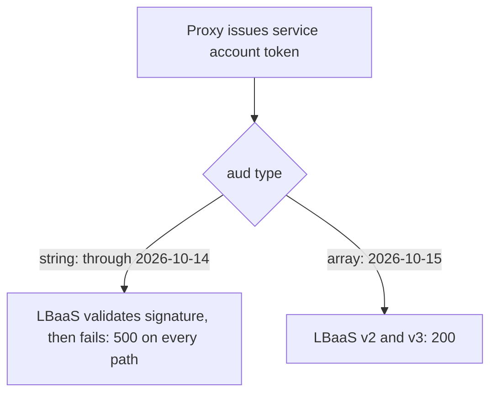

# PoC Report: LBaaS Proxy Service Auth

**Research question answered:** Why does an access token issued by the new proxy service for a service account get rejected with HTTP 500 by the LBaaS API, and which part of the service-to-service flow causes it?

## Verdict

The failure from the [source test](https://confluence.rakuten-it.com/confluence/spaces/UCP/pages/6977413500/New+Proxy+Service+-+LBaaS+Test) reproduced on every run through 2026-10-14. The cause is the type of the `aud` claim: tokens issued with `aud` as a JSON string (`"rns:roc:lbaas"`) return 500 from LBaaS, and tokens issued with `aud` as an array (`["rns:roc:lbaas"]`) return 200.

**Status: resolved.** On 2026-10-15 the proxy issues the same service account token with `aud` as an array. LBaaS v2 (`qa2-lbaas.r-local.net`) and LBaaS v3 (`qa-jpe2-user-dlb.r-local.net`) both return 200 for it. Nothing else in the token changed.

## Findings

### Finding 1 — `aud` as a string caused the 500 (resolved)

| Aspect | Detail |
|---|---|
| Symptom | `GET /v2/tenants` returned `500 {"message":"Internal Server Error"}` for the proxy token; the same 500 occurred on `/`, `/v2`, `/v2/health`, `/healthz` |
| Cause | `aud` in the proxy token was the string `rns:roc:lbaas`. A QA2 portal user token, which LBaaS accepted, carries `aud` as an array |
| Resolution | The proxy issues `aud` as an array. The same JWK and the same request now return 200 on LBaaS v2 and v3 |
| Evidence | Only `aud` differs between the failing and the passing proxy token; `azp`, `iss`, groups and claim names are identical (see the table below) |
| Residual uncertainty | The PoC cannot see what changed server-side. A simultaneous LBaaS change is not excluded; the claim difference and the matching result change are the evidence |
| Behavior note | LBaaS answers a string `aud` with 500 after signature validation, not with 401 or 403 |

### Finding 2 — the client controls the target service, not the `aud` type or `azp`

| Input | Effect |
|---|---|
| Assertor `aud` `rns:roc:caas` | Token for `rns:roc:caas`, groups `rns:roc:caas::clsd-ucp:roles:admin`, `expires_in=600` |
| Assertor `aud` as single-element array, `scope` parameter, or both | No change to the issued token |
| Assertor `aud` with two services | 401 `invalid_client`, "client authentication failed" |
| Assertor `aud` `lbaas` (bare) | 400 `invalid_target`, "unknown audience" |
| Any of the above | `azp` stays `rns:roc:iam` |

The assertor `aud` selects one known service by its full identifier. The `aud` type in the issued token is decided by the proxy.

### Finding 3 — `azp` and extra claims are not required

The passing proxy token has `azp=rns:roc:iam` (not among its `aud` entries) and only these claims: `aud`, `azp`, `email`, `email_verified`, `exp`, `groups`, `iat`, `iss`, `jti`, `sub`, `typ`. LBaaS accepts it, so `azp` alignment and the portal-only claims (`preferred_username`, `name`, `sid`, `scope`, `auth_time`) are not required.

### Finding 4 — LBaaS v3 is reachable on the QA user DLB hosts

| Host | `/v3/...` result |
|---|---|
| `qa-jpe2-user-dlb.r-local.net` | `/v3/version` 200, `/v3/tenants` 200 |
| `qa2-lbaas.r-local.net` | `/v3/tenants` 404 `{"message":"Not Found"}` (serves the v2 prefix) |
| `jpw2-user-dlb.r-local.net` | `/v3/tenants` 401 `{"message":"Failed to authenticate: invalid auth token"}` (prod host; the QA2 realm token is not accepted) |

`qa-jpc1-user-dlb.r-local.net` and `qa-jpe1-user-dlb.r-local.net` resolve; they were not called. The QA v3 hosts are not listed in the OneCloud documentation, which lists Prod and Dev hosts only (see `evidence.md`).

## What the PoC proved

| Finding | Observed |
|---|---|
| Failure reproduced | Proxy 200, LBaaS 500, identical across runs 1 and 2 and across every client-side variant |
| The issuer is not the cause | `iss` resolves and serves OIDC discovery and JWKS; a portal token with the same issuer is accepted |
| The LBaaS groups are not the cause | The portal token and the proxy token carry the same two LBaaS groups |
| The 500 depends on the token | Bad signature gives 403, no or malformed token redirects to login, the portal token gives 200 |
| The `aud` string-to-array change coincides with 500 turning into 200 | Observed on LBaaS v2 and v3 |
| Wrong-realm tokens are rejected | A prod-realm user token gets 403 on QA2 v2 |

## What the PoC did not prove

- The server-side error that LBaaS produced for a string `aud`. Only the LBaaS owners can read it using the request IDs below.
- What the proxy owners changed, and whether the array `aud` is a permanent setting.
- Behavior of `qa-jpc1-user-dlb` and `qa-jpe1-user-dlb`.

## Observed data

### Failing and passing proxy token vs QA2 portal user token

| Claim | Proxy token, string `aud` (500) | Proxy token, array `aud` (200) | QA2 portal user token (200) |
|---|---|---|---|
| `iss` | `https://qa2-accounts-onecloud.rakuten-it.com/auth/realms/roc` | same | same |
| `aud` | string `rns:roc:lbaas` | array `["rns:roc:lbaas"]` | array of 12 services including `rns:roc:lbaas` |
| `azp` | `rns:roc:iam` | `rns:roc:iam` | `rns:roc:portal` |
| LBaaS groups | `lbaas-operator`, `lbaas-viewer` for `clsd-ucp` | same | same |
| Claim names | `aud azp email email_verified exp groups iat iss jti sub typ` | same | adds `auth_time family_name given_name name preferred_username scope sid` |
| Lifetime | 43200 s | 43200 s | 600 s |
| `GET /v2/tenants` | **500**, `x-request-id: ia-v2-vcmINfyQnbDIQ0zYU2IatZ27QL` | **200**, `x-request-id: ia-v2-lNeWJ8YiogqGOGgVKTwkmfBhE3` | **200**, `x-request-id: ia-v2-VW8mKOVQrSH2ISiCRRlcdgBQcE` |

### Runs with the string `aud` (`run-output.txt`, `run-output-2.txt`)

| Step | Run 1 | Run 2 |
|---|---|---|
| Proxy `/token` | 200, `expires_in=43200` | 200, `expires_in=43200` |
| Issuer DNS / discovery / JWKS | `100.95.60.125` / 200 / 200 | same |
| `GET /v2/tenants` | 500, `ia-v2-vcmINfyQnbDIQ0zYU2IatZ27QL` | 500, `ia-v2-f6mXd3E5CIkw2WVplcJgtKov6p` |
| `GET /` | 500, `ia-v2-zV4DeTtwSCrSLgXCEDJJ4nrt56` | 500, `ia-v2-cTpJUx1EglfMqsN01MMfJjBnz8` |
| `GET /v2` | 500, `ia-v2-he0dLJcG2WNi5czmJcDqhBNWsL` | 500, `ia-v2-pCWso0iAzDSmIcFY0rfBP0maww` |
| `GET /v2/health` | 500, `ia-v2-1U56LWpJD3C5T1bV0KIyeXwZHJ` | 500, `ia-v2-cPHY05poQvGOx9tUKKNkWPvOoK` |
| `GET /healthz` | 500, `ia-v2-92uNUiuLEROSrKi7x0vlpGFYCV` | 500, `ia-v2-8xgaQTDVC6sJymNFyFWYwxLgn0` |
| `GET /v2/tenants`, no token / malformed / bad signature | 200 login HTML / 200 login HTML / 403 | same |

### Client-side variants (`run-output-variants.txt`)

| Variant | Proxy `/token` | Issued `aud` | Issued groups | `azp` | `GET /v2/tenants` |
|---|---|---|---|---|---|
| A: assertor `aud` `["rns:roc:lbaas"]` | 200 | string | lbaas-operator, lbaas-viewer | `rns:roc:iam` | 500, `ia-v2-OZLf4J3T70T5qIQcJ8hF7AL1qo` |
| B: `scope=openid profile rns:roc:lbaas` | 200 | string | same | `rns:roc:iam` | 500, `ia-v2-cYcJYPOv4dXP89OofofQVlP3Mz` |
| C: A and B | 200 | string | same | `rns:roc:iam` | 500, `ia-v2-XV9EpSpkRYqO4gYfGZgyUjbfYR` |
| D: assertor `aud` `["rns:roc:lbaas","rns:roc:caas"]` | 401 `invalid_client` | none | none | none | not called |
| E: assertor `aud` `rns:roc:caas` | 200, `expires_in=600` | string `rns:roc:caas` | `rns:roc:caas::clsd-ucp:roles:admin` | `rns:roc:iam` | 403 |
| F: assertor `aud` `lbaas` | 400 `invalid_target` | none | none | none | not called |

### Runs with the array `aud`, v2 and v3 (2026-10-15)

| Variant | v3 host | `GET /v2/tenants` (qa2-lbaas) | v3 result |
|---|---|---|---|
| G | `qa2-lbaas.r-local.net` | 200, `ia-v2-lNeWJ8YiogqGOGgVKTwkmfBhE3` | `/v3/tenants` 404, `ia-v2-QGaRWKaaf0LzAhsHWuNeGHdag7` |
| H | `jpw2-user-dlb.r-local.net` | 200, `ia-v2-PedaAI9LbK94PlBtrITQPU6Lw2` | `/v3/tenants` 401 `Failed to authenticate: invalid auth token`, `Www-Authenticate: Bearer realm="LBaaS"` |
| I | `qa-jpe2-user-dlb.r-local.net` | 200, `ia-v2-uknyO9diR3dt9GKVr14dGoQjXp` | `/v3/version` 200 `ia-v3-6mUQSIoQw88KX6pwCRF3mbJ06Q`; `/v3/tenants` 200 `ia-v3-KcI67t7U8UeJV6Ijj5ANvPD5GU` |

Variant I responses: `/v3/version` returns `version=v3.2.7`, `api_region=jpe2`, `cassandra_keyspace=lbaas_jpe2`, `deployment_date=2026-09-10 23:43:14`. `/v3/tenants` returns the `clsd-ucp` tenant with `region_usage_list=["jpe1","jpe2"]`.

### Other realm user token

| Call | Result |
|---|---|
| `GET /v2/tenants`, token with `iss=https://accounts-onecloud.rakuten-it.com/auth/realms/roc` | 403 |
| `GET /v2/health`, same token | 403 |

## Hypothesis outcomes

| ID | Outcome |
|---|---|
| H1 issuer not resolvable or trusted | Not supported. The issuer resolves and serves discovery and JWKS, and a token with the same issuer is accepted. |
| H2 missing or unexpected claim causes an unhandled error | Not supported as stated. The claim set is unchanged between the failing and passing token; only the `aud` type differs. |
| H3 endpoint fault independent of the token | Not supported. Responses differ by token (403, login redirect, 500, 200). |
| H4 `aud` as string, LBaaS expects an array | Supported. 500 with a string `aud`, 200 with an array `aud`, all other claims equal. |
| H5 `azp` not in `aud` | Not supported. `azp=rns:roc:iam` is not in `aud` in the passing token. |

## Recommendation

1. Confirm with the proxy owners that issuing `aud` as an array is intended and permanent, so the fix does not regress.
2. Report to the LBaaS owners that a string `aud` produces a 500 after signature validation instead of 401 or 400. The failing request IDs above allow them to find the server-side error. RFC 7519 allows `aud` as a string or an array (see `evidence.md`), so the LBaaS gateway should accept both.
3. Keep `lbaas-proxy-auth-poc` as a regression check for the proxy: it prints the `aud` type and the LBaaS v2 and v3 results in one run.
4. Add the QA v3 hosts (`qa-<region>-user-dlb.r-local.net`) to the OneCloud LBaaS v3 documentation, which lists Prod and Dev hosts only.

## Related

- [design.md](design.md) — scope, hypotheses, approach
- [implementation.md](implementation.md) — code and how it was run
- [evidence.md](evidence.md) — source test facts, claim definitions and LBaaS v3 endpoints
