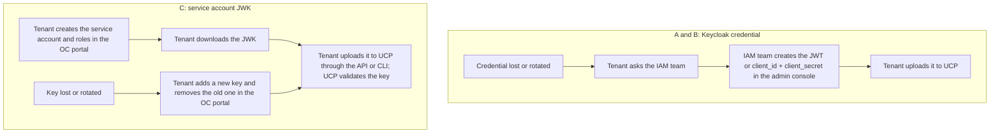
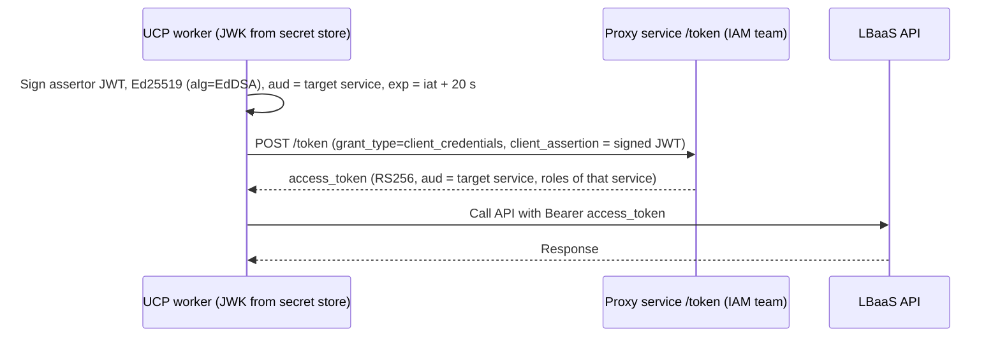
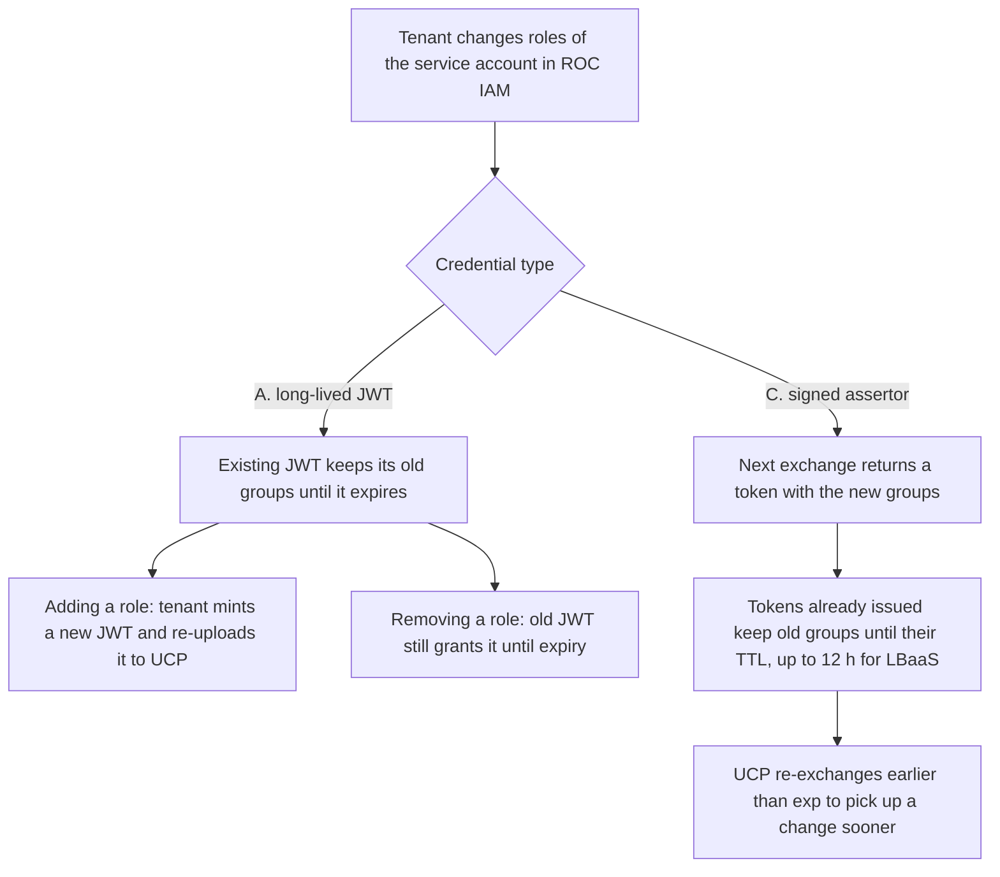

# OneCloud Service Account Authentication — Long-Lived Token vs Signed Assertor

| | |
|---|---|
| **Author** | aripermana.putra |
| **Date** | 2026-10-15 |
| **Purpose** | Compare the credential a tenant gives UCP so that UCP can call Rakuten OneCloud (ROC) service APIs such as LBaaS on the tenant's behalf |

---

## Summary

UCP calls ROC service APIs with a tenant-owned service account. Three ways to authenticate that service account exist:

- **A. Long-lived JWT** minted from the Keycloak admin console and handed to UCP.
- **B. Client credentials** (`client_id` + `client_secret`) exchanged at Keycloak for a short-lived access token. This is the option recorded in [credential-management.md](credential-management.md), and it works in QA against six ROC services ([test page](https://confluence.rakuten-it.com/confluence/spaces/UCP/pages/6780953915/Service+-+Service+Authentication+KeyCloak+Service+Account)).
- **C. Signed assertor**: the tenant downloads the service account's JWK, UCP signs a 20-second JWT with it and exchanges it at the new proxy service for a short-lived access token.

Option C was exercised end to end against LBaaS v2 and v3 in QA (see [Related PoCs](#related-pocs)). It is the only option a tenant can set up and recover without the IAM team: A and B require the Keycloak admin console, which tenants cannot access, while C uses a service account and JWK created in the OC portal. Compared with A, it also keeps no bearer secret in circulation, picks up role changes at the next exchange instead of at re-issue, supports key rotation without downtime, and limits a leaked access token to the service's TTL. It adds a dependency on the proxy owned by the IAM team and requires UCP to sign and cache tokens.

**Recommended direction:** C. The decision is pending the IAM-team questions below.

---

## Problem

A tenant onboards to UCP and must give UCP a credential that lets UCP create infrastructure on the tenant's behalf. For ROC the credential belongs to a service account that carries the tenant's roles, for example `lbaas-operator` for LBaaS. The credential type determines what UCP stores, what travels to ROC on every call, how role changes take effect, and how a leak is contained.

## Why It Matters

- UCP stores credentials for many tenants and uses them from background workers (provisioning workflows, drift detection) where no user is present. A leaked credential gives access to a tenant's infrastructure.
- The credential outlives individual requests, so rotation, role changes and revocation must work without asking every tenant to re-upload on each change.
- Several ROC services are in scope (LBaaS first), each with its own roles and token lifetime.
- Onboarding time and recovery effort depend on who can create and replace the credential. If every creation, rotation or loss needs a ticket to another team, tenant onboarding is slow and unpredictable.

---

## Findings

### The three credential artifacts

| | A. Long-lived JWT | B. Client credentials | C. Signed assertor |
|---|---|---|---|
| Tenant gives UCP | A JWT with a long expiry | `client_id` + `client_secret` | The service account JWK (private key) |
| Nature of the secret | Bearer: whoever holds it can call | Shared secret sent to the token endpoint | Private key; only signatures leave the client |
| Sent to ROC services | The secret itself, on every call | A short-lived access token | A short-lived access token |
| Sent to the token endpoint | Nothing | The secret, on every exchange | A 20-second signed assertor |

### Who can create and recover the credential

Tenants have no access to the Keycloak admin console. A long-lived JWT (A) and a `client_id` + `client_secret` (B) are both created there; the B test page starts with "Request IAM team to create a KeyCloak service account" through the IAM request form. Each creation, rotation and recovery after a loss therefore goes through the IAM team. Neither is self-service or automated, and the turnaround depends on the IAM team's availability. Option C uses the service account and JWK created in the OC portal, as in the [source test](https://confluence.rakuten-it.com/confluence/spaces/UCP/pages/6977413500/New+Proxy+Service+-+LBaaS+Test) ("Create a SA in OC QA env with necessary roles and permissions", "Generate and download the JWK").

Adding, listing and deleting JWKs in the OC portal is fully self-service for tenants, and a service account can hold at most 5 JWKs at a time. Losing a key, or rotating one, therefore needs no IAM-team request.

The tenant generates, downloads and manages the JWK in the OC portal and uploads it to UCP through the UCP API or CLI. The portal generates the key, so the tenant does not choose its algorithm. Ed25519 (`kty=OKP`, `crv=Ed25519`) is the only algorithm confirmed with the proxy, and UCP does not need to support others. UCP validates the JWK at upload: it must contain the private part (`d`), `kty` must be `OKP`, `crv` must be `Ed25519`, and `kid` must be present. Any other key is rejected with a clear error at upload time instead of failing later at signing time.

### Observed behavior of option B

The [Keycloak service account test](https://confluence.rakuten-it.com/confluence/spaces/UCP/pages/6780953915/Service+-+Service+Authentication+KeyCloak+Service+Account) (QA) records:

| Aspect | Observed |
|---|---|
| Creation | "Request IAM team to create a KeyCloak service account" through the IAM request form; `clientId` and `client secret` are then read from the Keycloak admin console |
| Token call | `POST https://qa2-accounts-onecloud.rakuten-it.com/auth/realms/roc/protocol/openid-connect/token` with `client_id`, `client_secret`, `grant_type=client_credentials` |
| Response | `expires_in: 600`, `refresh_expires_in: 0` (no refresh token), `scope: "madara profile email"` |
| Services that accepted the one token (QA) | CoreData, LBaaS (`/v2/tenants`), MONaaS, CaaS, VMaaS, DBaaS (OMNIA): all passed. STaaS was not filled in |

The token is valid across several services without choosing a target, and its lifetime is 10 minutes. A client re-requests a token with the same credentials when it expires. The 10-minute lifetime is the same as the QA user token lifetime recorded in the [session revoke PoC](../pocs/keycloak-session-revoke.md).

### Flow of option C

The assertor follows the OAuth 2.0 JWT client-assertion pattern ([RFC 7523](https://www.rfc-editor.org/rfc/rfc7523)): the client proves its identity with a signature instead of sending a secret. The JWK is `kty=OKP`, `crv=Ed25519`; the private part (`d`) never leaves UCP, and the proxy verifies the signature against the account's public key identified by `kid`. The PoC signing code needs only the Go standard library.

### Access token properties observed through the proxy

| Property | Observed |
|---|---|
| Target service | Chosen by the assertor `aud`. A single full identifier (`rns:roc:lbaas`) is accepted; a bare name (`lbaas`) is rejected with `invalid_target`, and several services in one assertor are rejected |
| Roles in the token | Only those of the target service: `lbaas-operator` and `lbaas-viewer` for `rns:roc:lbaas`; `admin` for `rns:roc:caas` |
| Lifetime | 43200 s for LBaaS, 600 s for CaaS. The client cannot change it; a requested `scope` and the assertor format have no effect |
| `aud` type | Array. A string `aud` caused LBaaS to return 500 until the proxy changed it; the array form is permanent |
| `azp` | `rns:roc:iam` for every service, independent of client input |

The token lifetime is a server-side setting that can be configured per service and shortened for UCP.

### Role changes

- A JWT is self-contained: its `groups` claim is fixed when it is minted ([RFC 7519](https://www.rfc-editor.org/rfc/rfc7519)). LBaaS v3 (QA) honors the roles inside a token and does not check them again: after `lbaas-operator` was removed from the service account, a token issued before the removal still passed an operator-only call, while a token issued after it was refused with 403. A long-lived JWT therefore keeps its roles for its whole lifetime. A role change against a long-lived JWT itself was not tested.
- With C the proxy builds the `groups` claim at each exchange from the service account's current roles (different groups per target service). The token issued about a minute after `lbaas-operator` was removed carried only `lbaas-viewer`, with no cache delay. Minting a new token does not invalidate older ones: each stays valid until its own `exp`, 12 hours for LBaaS.

### Revocation and rotation

- Keycloak does not revoke access tokens actively; the [session revoke PoC](../pocs/keycloak-session-revoke.md) measured a 10-minute residual window for QA user tokens, and an offline token with no expiry. A JWT with a long expiry therefore stays usable for its full lifetime after a leak unless the signing key is rotated at the realm.
- With C, removing the service account key at ROC stops new tokens immediately. Tokens already issued survive until their TTL (up to 12 h for LBaaS).
- A service account can hold up to 5 JWKs at once, so a tenant can add a new key, upload it to UCP, switch over and then remove the old key with no gap. The limit leaves room for UCP's key plus the tenant's own keys and a rotation overlap.

### Dependency and failure behavior

- The proxy is owned by the IAM team (which also runs Keycloak) and is supported (But not yet in production as of this writing). Its SLA is not yet known.
- A cached access token covers an outage for the length of its TTL: hours for LBaaS, only 10 minutes for CaaS (QA TTL, should be able to configure it by asking IAM team). Beyond that UCP cannot obtain new tokens.
- In QA the proxy exposed one defect (string `aud`), which LBaaS answered with 500 instead of 401. The defect is resolved (by changing `aud` to array instead of string).

### What each option leaves open

All three options store a long-lived secret for each tenant. Exfiltration of that secret from UCP's secret store (GCP secret manager is planned, with ESO used to synchronize secret to UCP Crossplane k8s cluster) remains the main residual risk, as already recorded in [cloud-provider-authz-model.md](cloud-provider-authz-model.md). C changes where a stolen secret works (only through the proxy, where each exchange can be logged and the tenant can disable the key) and what travels on every call; it does not remove the risk.

---

## Options

| | A. Long-lived JWT | B. Client credentials | C. Signed assertor |
|---|---|---|---|
| Who creates it | IAM team (Keycloak admin console) | IAM team (Keycloak admin console) | Tenant (OC portal) |
| Who recovers or rotates it | IAM team | IAM team | Tenant (OC portal, up to 5 keys per account) |
| What UCP stores | Bearer JWT | `client_id` + `client_secret` | JWK private key |
| Secret on the wire | On every API call | On every exchange | Never |
| Role added | Re-mint and re-upload | Next exchange | Next exchange |
| Role removed | Effective at JWT expiry | New tokens at once; issued tokens until their TTL (600 s in QA) | New tokens at once; issued tokens until their TTL (measured on LBaaS: up to 12 h) |
| Early revocation | Not possible for the JWT; realm key rotation only | Rotate the secret | Remove the key |
| Rotation without downtime | Replace the JWT | To be confirmed with IAM | Up to 5 keys per account |
| Scope of one token | Whatever the JWT covers | All services the account has roles for (one token passed on six services) | One service, only its roles |
| Access token lifetime | Set at mint (long) | 600 s (QA) | 43200 s for LBaaS, 600 s for CaaS; (QA) configurable per service |
| UCP implementation | Lowest | Token call + cache | Signing + token call + per-service cache |
| New dependency | None | Keycloak | Proxy service |
| Available for ROC service accounts | Yes (admin console) | Yes (tested in QA, created through an IAM request) | Yes (tested in QA) |

## Recommendation

Prefer **C** over **A** and **B**:

- tenants onboard, rotate and recover the credential themselves, without an IAM-team ticket, so onboarding time does not depend on another team's availability;
- no bearer secret is in circulation and no long-lived secret is sent to service APIs;
- role changes need no re-upload, and the delay is bounded by the service's token TTL, which the IAM team can shorten;
- rotation works without downtime, and early revocation is a key removal;
- the credential shape (a private key that signs a request for a short-lived token) matches how UCP already handles GCP service account keys.

B is simpler for UCP to implement, issues 10-minute tokens, and one token works across the ROC services tested. It has the same dependency on the IAM team as A for creation, rotation and recovery, so it does not solve the onboarding problem. A B token also covers every service the account has roles for, whereas a C token is limited to the one service requested.

C's weaker point against B is the LBaaS token lifetime: 12 hours through the proxy against 10 minutes for B (QA). The IAM team can configure the proxy lifetime per service, so UCP should ask for a value close to B's for the services it uses.

A removed role keeps working on tokens issued before the removal, so the token lifetime is the only limit on that window. UCP should discard its cached token when a tenant changes roles or when a call returns 403, and mint a new one.

UCP stores the JWK in GCP Secret Manager and synchronizes it to the UCP Crossplane Kubernetes cluster with the External Secrets Operator.

---

## Open Questions

| Question | Owner |
|---|---|
| Does the proxy reject a reused assertor `jti`? | IAM team |
| What is the proxy SLA, and how should UCP behave while it is down? | IAM team |
| What are the token TTLs of every ROC service UCP will use, and what values can be set for UCP? | IAM team |
| Which tenant role is required to create a service account, assign its roles and manage its keys? Is the same available through an API for UCP-guided onboarding? | IAM team |
| How is the long-lived JWT minted from the admin console, and what expiry can it have? | IAM team |
| Does the production proxy behave like QA (same claims, `aud` array, TTLs, hosts)? | IAM team |
| Do ROC services other than LBaaS accept the proxy token the same way? | UCP team |

---

## Related PoCs

- [LBaaS Proxy Service Auth PoC](../pocs/lbaas-proxy-service-auth.md) — reproduced and explained a 500 from LBaaS on proxy tokens (string `aud`, now resolved), measured which inputs the client controls, and verified the proxy token against LBaaS v2 and v3 in QA. Source test: [New Proxy Service - LBaaS Test](https://confluence.rakuten-it.com/confluence/spaces/UCP/pages/6977413500/New+Proxy+Service+-+LBaaS+Test).
- [Keycloak Session Revoke PoC](../pocs/keycloak-session-revoke.md) — Keycloak token revocation behavior.

## Related Research

- [Credential Management for UCP](credential-management.md)
- [Cloud Provider Authorization — Service Account Strategy](cloud-provider-authz-model.md)

---

## References

- [New Proxy Service - LBaaS Test (Confluence)](https://confluence.rakuten-it.com/confluence/spaces/UCP/pages/6977413500/New+Proxy+Service+-+LBaaS+Test)
- [Service - Service Authentication (KeyCloak Service Account) (Confluence)](https://confluence.rakuten-it.com/confluence/spaces/UCP/pages/6780953915/Service+-+Service+Authentication+KeyCloak+Service+Account)
- [RFC 6749 — OAuth 2.0, Client Credentials Grant](https://www.rfc-editor.org/rfc/rfc6749#section-4.4)
- [RFC 7519 — JSON Web Token (JWT)](https://www.rfc-editor.org/rfc/rfc7519)
- [RFC 7523 — JWT Profile for OAuth 2.0 Client Authentication and Authorization Grants](https://www.rfc-editor.org/rfc/rfc7523)
